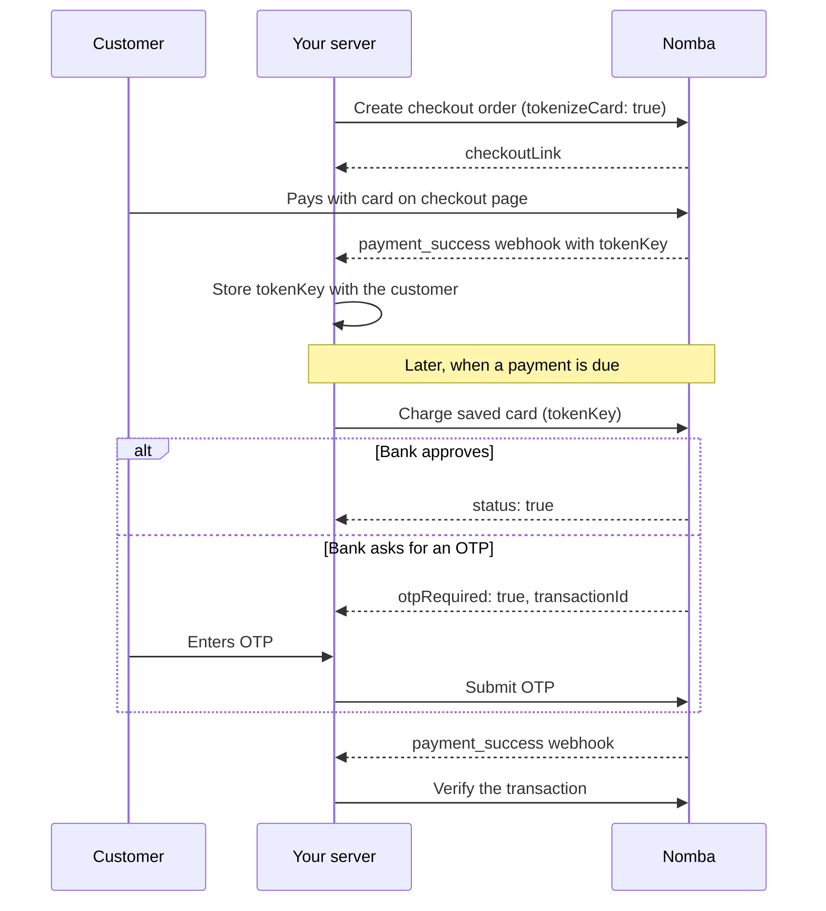

Recurring payments let you charge a customer again without asking for their card details each time. The customer pays once with their card on the Nomba checkout page. Nomba saves the card and gives you a **card token** (`tokenKey`). From then on, you charge the card by sending that token.

This section uses the **Nomba checkout page** for the first payment: you send the customer to a payment link, and Nomba collects their card details. To collect card details on your own page instead, see [Recurring payments with the API](/docs/products/accept-payment/recurring-payments/api/overview).

Use recurring payments for:

- Subscriptions and memberships
- Instalment plans
- Automatic top-ups, such as wallet or airtime reloads
- One-click repeat purchases ("Pay with saved card")

## How it works

<Steps>
  <Step title="Create a checkout order">
    Create the first order with `tokenizeCard: true` and send the customer to the `checkoutLink` to pay. [Create a checkout order →](/docs/products/accept-payment/recurring-payments/hosted-checkout/create-checkout-order)
  </Step>
  <Step title="Store the card token">
    Read the `tokenKey` from the `payment_success` webhook and save it with your customer's record. [Store the card token →](/docs/products/accept-payment/recurring-payments/hosted-checkout/store-the-card-token)
  </Step>
  <Step title="Charge a saved card">
    When a payment is due, send the `tokenKey` and the amount to Nomba. [Charge a saved card →](/docs/products/accept-payment/recurring-payments/hosted-checkout/charge-a-saved-card)
  </Step>
  <Step title="Complete an OTP challenge, if the bank asks for one">
    Some banks ask the customer to approve a charge with an OTP. Collect it and submit it. [Complete an OTP challenge →](/docs/products/accept-payment/recurring-payments/hosted-checkout/complete-otp)
  </Step>
  <Step title="Confirm the charge">
    Verify the final status before you give the customer value. [Confirm the charge →](/docs/products/accept-payment/recurring-payments/hosted-checkout/confirm-the-charge)
  </Step>
</Steps>

## What Nomba does and what you do

| Nomba | You |
|---|---|
| Keeps the card details secure and gives you a token to charge it with | Get the customer's permission to save their card and charge it later |
| Sends the charge to the customer's bank | Store each token against the right customer |
| Tells you when the bank needs an OTP | Decide **when** to charge. Nomba charges a saved card only when you call the API. |
| Sends a webhook when a charge succeeds or fails | Collect the OTP from the customer when it's needed |
| | Verify every charge before you give value, and handle failed charges |

<Note>
  If you don't want to run your own billing schedule, use a [payment link](/docs/guides/accept-payment-with-payment-links) with a recurring frequency instead. Nomba then saves the customer's card on the first payment and charges it daily, weekly, monthly or on another schedule you choose. This guide is for merchants who want to control billing from their own server through the API.
</Note>

## Before you begin

- **API keys and an access token.** See [Obtain API keys](/docs/getting-started/get-api-keys) and [Authenticate](/docs/getting-started/authentication).
- **A webhook URL.** The card token arrives in a webhook. See [Setting up webhooks](/docs/guides/setting-up-webhooks).
- **Card payments enabled on your account.** Saving a card doesn't need to be switched on separately, but every charge on a saved card is a card payment. If card payments aren't enabled for your business, the charge is rejected with "Card payment is not supported for this order". Contact Nomba support to enable them.

## Key terms

| Term | Meaning |
|---|---|
| **Saved card** | A card that Nomba has stored so you can charge it again. A customer can have more than one. |
| **Card token (`tokenKey`)** | The value you send to charge a saved card. It isn't the card number, and it only works with your API credentials and the email it was saved with. Keep it on your server and never expose it to the browser or app. |
| **OTP challenge** | A step in which the customer's bank asks them to approve a charge with a one-time password sent to their phone or email. |

<Card title="Next: Create a checkout order" icon="arrow-right" href="/docs/products/accept-payment/recurring-payments/hosted-checkout/create-checkout-order">
  Create the order that saves the customer's card.
</Card>
